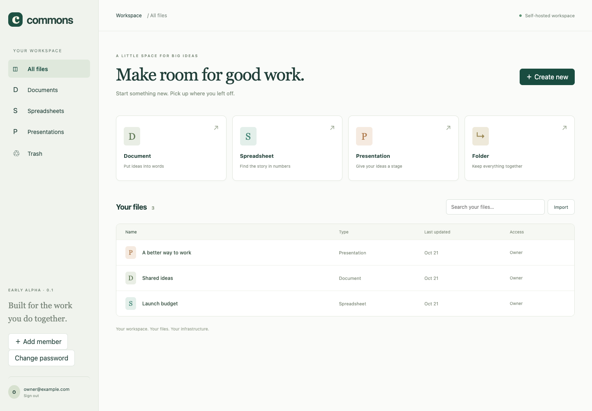

# Commons Suite

[](https://github.com/Hillru/commons-suite/actions/workflows/ci.yml)

**An open workspace for documents, numbers, and ideas.**

Commons Suite is a free, Apache-2.0 licensed, self-hosted productivity-suite alpha. It combines collaborative writing, basic spreadsheets, simple presentations, and shared folders in one browser application.

Repository: [Hillru/commons-suite](https://github.com/Hillru/commons-suite).

**Status: developer preview, not production enterprise software. No Microsoft Office parity is claimed.** “Commons Suite” is a working name; trademark and domain clearance are pending.



## Run locally

Requires Node.js 24 and npm. No external database is needed for the alpha.

```sh
npm ci
cp .env.example .env
# Edit .env: choose your administrator email and a unique 12+ character password.
npm run build
npm start
```

Open **http://localhost:3000**. Sign in with the administrator credentials from your .env. Add workspace members from the sidebar, then share individual files or folders. Do not commit .env or data/.

The web application uses port 3000; document collaboration uses port 3001. PUBLIC_ORIGIN must exactly match the browser origin, including port. Use localhost consistently rather than switching to 127.0.0.1.

## What works today

| Module | Alpha behavior |
| --- | --- |
| Documents | Rich text, headings, lists, quotes; live Yjs coediting; persistent collaboration state; server-generated export snapshots |
| Spreadsheets | Multiple sheets, 26 × 100 visible cells per sheet; arithmetic, references, SUM ranges; explicit save; single-session editing lease |
| Presentations | Title/body slides, background colors, add/remove slides, slideshow view; explicit save and editing lease |
| Files | Folders, search by name, rename, trash/restore, member sharing and inherited folder access |
| Accounts | Administrator-created users, salted password hashes, expiring server-side sessions, password-change API |
| History | Saved content revisions; sheet/slide restore; document revision listing |
| Formats | Basic DOCX/XLSX import; text-only DOCX, HTML, XLSX, first-sheet CSV, PPTX, native JSON export |

Imported originals are retained and downloadable through the API. The import report explicitly identifies limitations. Documents export from persisted collaboration state; “Save export snapshot” creates a history revision. Sheet/slide changes must be saved before export.

## Deliberate limitations

- No SSO/OIDC, MFA, account recovery email, public links, comments, rich presence indicators, images in editors, chart editor, desktop sync, or offline editing.
- Sheets and slides use editing leases per session, not simultaneous editing. Leases expire after 45 seconds and renew every 20 seconds.
- A stale revision is rejected rather than overwritten. Reopen a conflicted file to load its latest revision.
- Live document revision restore is deferred until CRDT snapshots can be restored atomically. Current document content survives reload/restart.
- Spreadsheet display is limited to A1:Z100. Imported cells outside that area remain in the model/export but cannot be edited in this view.
- DOCX export preserves paragraph text, not rich formatting. Import simplifies styling. XLSX import drops styles, charts, and unsupported workbook features. PPTX import is not implemented.
- JSON is an export/backup format, not an implemented import format. PDF export and OpenDocument formats are planned.
- One organization, one server process, SQLite storage. No certified user/concurrency capacity, HA, or compliance claims.
- Basic process isolation for imports is implemented, but OS-level network/filesystem isolation and antivirus scanning are not. Do not expose this alpha to untrusted public uploads.
- The dependency scan currently reports a moderate upstream issue in Mammoth's command-line dependency chain. See [security notes](docs/SECURITY.md).

## Verification

```sh
npm test
npm run check
npm run build
npx playwright install chromium
npm run test:e2e
npm audit --omit=dev --audit-level=high
npm run licenses
```

Browser tests start an isolated temporary server/database and cover sheet save/reopen/export, two-session document synchronization, slide editing, and narrow-screen navigation. On a machine with Chrome already installed, set PLAYWRIGHT_CHROME to its executable path.

## Self-hosting

```sh
cp .env.example .env
# Set a unique administrator password in .env.
docker compose up --build -d
```

The default Compose setup exposes only loopback ports. For a remote private pilot, put both HTTP and WebSocket services behind HTTPS, set PUBLIC_ORIGIN and COLLAB_URL to their public addresses, and enable COOKIE_SECURE. See [deployment](docs/DEPLOYMENT.md). The Docker recipe is provided but must be validated on a Docker-equipped host.

## Project map

- src/: React application and responsive UI.
- server/app.js: authenticated API and authorization.
- server/store.js: SQLite schema, sessions, revisions, and leases.
- server/documents.js: CRDT/document conversion.
- server/formulas.js: bounded spreadsheet evaluator; never JavaScript eval.
- server/import-worker.js: OOXML checks and conversion worker.
- tests/: backend, conversion, and browser checks.
- docs/: architecture, compatibility, security, delivery, and launch notes.

## Contributing and license

See [CONTRIBUTING](CONTRIBUTING.md), [architecture](docs/ARCHITECTURE.md), and [roadmap](docs/ROADMAP.md). Contributions stay under Apache-2.0. Preserve third-party notices; generated notices and a dependency inventory are in docs/.

This project uses independently written application code and licensed open-source components. It is not affiliated with Microsoft and includes no Microsoft branding, proprietary code, or bundled proprietary fonts.
